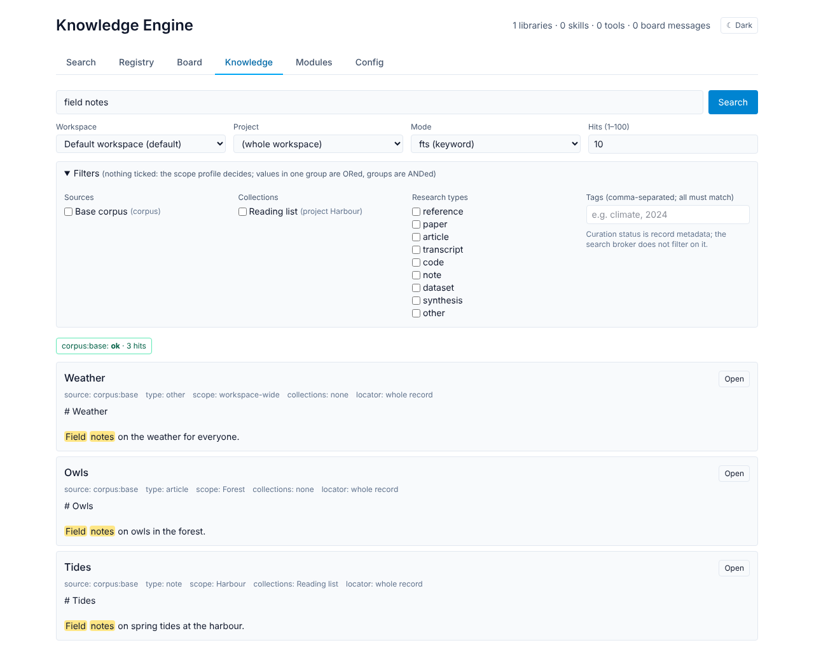
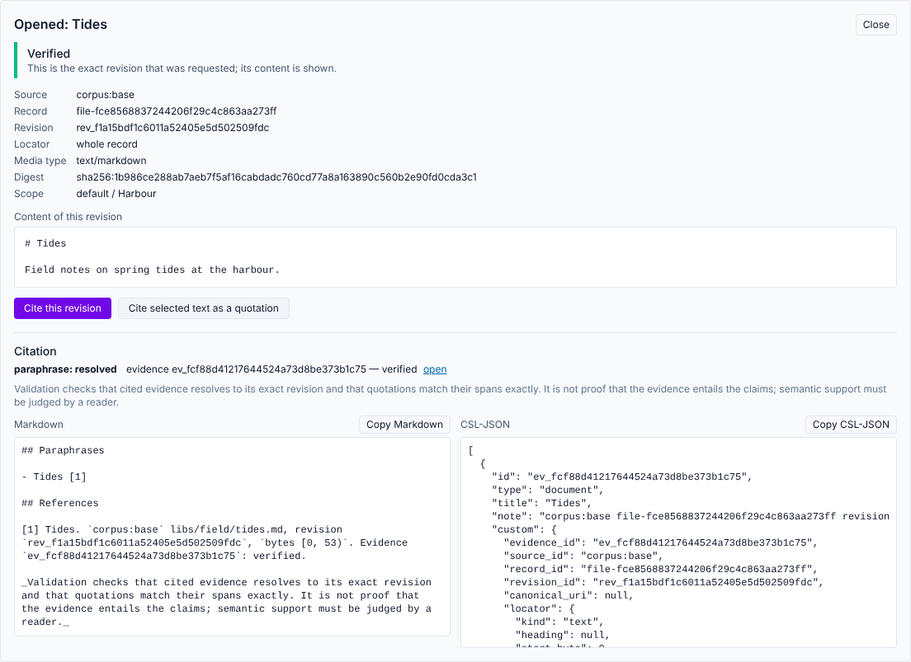

# The dashboard

`knowledge-engine serve` serves a browser dashboard at
<http://127.0.0.1:9210/ui/>. It is a thin client over the HTTP API: everything
it shows comes from the same routes the CLI and MCP use, and it adds no
behaviour of its own. Restyling it is covered in [THEMING.md](THEMING.md).

| Tab | What it does | API it calls |
| --- | --- | --- |
| Search | Keyword search over the whole corpus (the original, unscoped search) | `GET /search` |
| Registry | List entries, switch them on and off, trigger a reindex | `/registry`, `POST /search/reindex` |
| Board | Read, search, post and acknowledge agent-board messages | `/board/*` |
| Knowledge | Scoped search, exact-revision open, citations | `/knowledge/*` |
| Modules | Lifecycle state and health of registered modules | `/modules` (board admin key) |
| Config | Board settings, the browser's board key, API keys, provider bindings | `/board/*` |

The tabs are keyboard operable (arrow keys, Home, End). The colour scheme
follows the operating system until you pick one with the header toggle. Text
from your corpus (titles, excerpts, file content) is always displayed as text,
never interpreted as HTML.

## Knowledge: scoped search

The Knowledge tab searches one workspace through the retrieval broker, with
the semantics described in [KNOWLEDGE-SEARCH.md](KNOWLEDGE-SEARCH.md). It
needs the knowledge store: run `knowledge-engine knowledge migrate --apply`
first. The tab says so when the store is empty or `KE_KNOWLEDGE_ENABLED=0`.

- **Workspace and project.** Choose a project to search only its records.
  Tick *also records outside any project* to add workspace-wide records.
- **Mode and hits.** `fts`, `vector` or `hybrid`, and 1 to 100 hits.
- **Filters** (sources, collections, research types, tags). A group with
  nothing ticked is left to the scope profile. Values in one group are ORed,
  groups are ANDed, and every tag must be present. Filters apply before the
  hit limit. Curation status is record metadata; the broker does not filter
  on it.
- **Per-source status.** Each selected source reports `ok`, `unavailable`,
  `timeout` or `error`, with its hit count. When some sources fail, a
  *Partial result* warning says that their hits are missing. When every
  source fails (for example `vector` without an embedding index), the error is
  shown instead of an empty list.
- **Hits** show the title, source, research type, project, collection
  memberships, locator and the excerpt with the matched terms highlighted.

## Knowledge: opening records and citing them

**Open** fetches the hit's exact revision (`POST /knowledge/open`) and shows
its verification state, revision id, digest, locator and content.

| State | Shown as | Content |
| --- | --- | --- |
| `verified` | Verified | The requested revision |
| `stale` | Stale: a newer revision exists | The requested (older) revision, never the latest |
| `unavailable` | Unavailable | None |
| `ambiguous` | Ambiguous | None |
| `unsupported` | Unsupported: for example an older revision that was never recorded | None; the latest content is never substituted |

For text revisions that are verified or stale, two actions export a citation
through `POST /knowledge/citations/export`:

- **Cite this revision**: a paraphrase claim citing the whole revision.
- **Cite selected text as a quotation**: select a passage in the content
  first. The dashboard converts the selection to UTF-8 byte offsets, and the
  engine checks that the quotation matches that span exactly.

The result lists each claim's status (`resolved`, `unresolved`,
`unsupported`), each evidence item's verification state and any issues. It
also shows the Markdown references and CSL-JSON, with copy buttons. Citing
needs the revision in the evidence store, so run `knowledge-engine knowledge
snapshot --apply` first (see [CITATIONS.md](CITATIONS.md)). Without that, the
claim is reported `unresolved` with the reason. An evidence item's **open**
link re-opens that exact evidence through `POST /knowledge/evidence/open`.
This rechecks the scope and shows the current verification state.

## Modules

The Modules tab lists registered modules ([MODULES.md](MODULES.md)) with
their lifecycle state, state detail, transport, tools and active calls.
`degraded` (⚠, amber) and `failed` (✕, red) stand out from `ready` (●, green);
the label is always written out, not conveyed by colour alone. It also lists
the default workspace's module jobs.

`/modules` is guarded like the board's admin routes. Save a board admin key
in the Config tab (it is stored in this browser only and sent as
`X-Board-Key`); without one the tab says a key is needed. The only action is
**Check health**, the bounded health probe of an enabled module. Registering,
configuring, enabling and invoking modules stay CLI and API operations.
