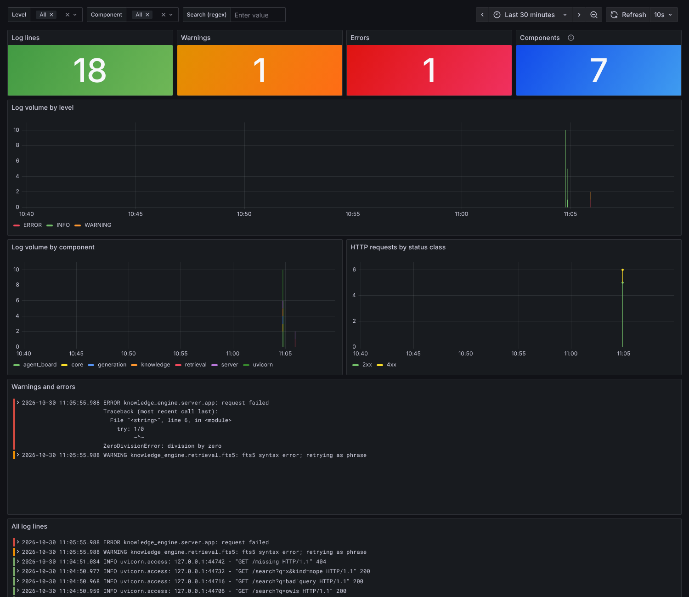

# Developer tooling

The services a contributor runs next to the code: Nox sessions that mirror CI,
pytest, structured logs shipped to Loki and shown in Grafana, Serena for
symbol-level code navigation, and a search index of this repository's own
documentation built with a local embedding model.

None of this is needed to use the engine. [CONTRIBUTING.md](../CONTRIBUTING.md)
covers setup and the gate; this page covers the tools around it.

| Tool | Entry point | What it gives you |
| --- | --- | --- |
| Nox | `uvx nox` | The CI checks, one command per job, in locked environments |
| pytest | `uvx nox -s tests-3.13 -- <args>` or `just test` | The test suite (random order, coverage) |
| Structured logs | `KE_LOG_FORMAT=json`, `KE_LOG_FILE` | One JSON object per log line, optionally in a rotated file |
| Loki, Alloy, Grafana | `deploy/observability/` | Log storage, shipping and a provisioned dashboard |
| Serena | `uvx nox -s serena` | An MCP server with symbol search and references for this checkout |
| Repository self-index | `uvx nox -s self_index` | Keyword, vector and hybrid search over the repo's docs |

## Nox

[`noxfile.py`](../noxfile.py) runs on the uv backend. Each session installs the
locked dependency groups from `engine/uv.lock` into its own environment under
`.nox/` (`uv sync --locked`), so a local run uses the same versions as CI.
Nox itself needs no install: `uvx nox`.

| Session | CI job it mirrors | Notes |
| --- | --- | --- |
| `lint` | lint | `ruff format --check`, `ruff check` |
| `typecheck` | lint | `mypy` (strict) and `registry validate` |
| `tests-3.12`, `tests-3.13`, `tests-3.14` | test | `pytest -p randomly --cov`; arguments after `--` replace the coverage flags |
| `ui` | dashboard (browser smoke) | Needs a Playwright Chromium |
| `docs` | docs | Docs paths and links; `CONFIGURATION.md` is current |
| `build` | build | sdist and wheel, `twine check`, clean-venv install smoke |
| `lock` | lint | `uv lock --check` |
| `self_index` | — | [Repository self-index](#repository-self-index) |
| `serena` | tooling | [Serena](#serena) |
| `observability` | tooling | `docker compose` for the stack; default `config -q` |

```bash
uvx nox                          # lint, typecheck, tests on 3.12-3.14, docs
uvx nox -s tests-3.13 -- -k broker -x
uvx nox -s ui build lock
uvx nox -R -s lint               # reuse the environment, skip the install step
```

`just check` remains the quick single-interpreter loop in your own virtualenv.
Nox is what to run before pushing a change that touches packaging, the Python
matrix or the docs.

## Structured logs

Two settings (see [CONFIGURATION.md](../01-user-docs/CONFIGURATION.md)) apply to the CLI and to
both servers:

- `KE_LOG_FORMAT=json` writes one JSON object per line. Keys: `ts` (UTC, ISO
  8601), `level`, `logger`, `message`, `process`, `thread`, `module`, `line`,
  `exc` and `stack` when present, and any `extra=` fields. uvicorn's own
  access and error lines switch to the same format.
- `KE_LOG_FILE=<path>` also writes the records to a size-rotated file (10 MiB,
  5 backups). An unwritable path is reported at WARNING and the process keeps
  logging to stderr.

```bash
KE_LOG_FORMAT=json KE_LOG_FILE=deploy/observability/logs/engine.jsonl \
  uv --project engine run knowledge-engine serve
```

## Observability: Loki, Alloy and Grafana

[`deploy/observability/`](../deploy/observability/compose.yaml) is a Docker
Compose stack for one developer machine:

- **Loki 3.5** stores log lines on a local volume, with 14 days of retention.
- **Grafana Alloy 1.11** tails `logs/*.jsonl`. It labels each line with `job`,
  `level` and `component` (the first package below `knowledge_engine`, or
  `uvicorn`). It keeps `logger`, `process` and `module` as structured metadata.
- **Grafana 12.2** has the Loki data source and the *knowledge-engine logs*
  dashboard provisioned. The dashboard shows line, warning and error counts,
  volume by level and by component, and HTTP status classes from the access
  log. It also lists warnings and errors with tracebacks and every line, and
  can be filtered by level, component and a regular expression.

All ports bind to `127.0.0.1`: Grafana on 3000, Loki on 3100 and Alloy's UI on 12345.

```bash
cd deploy/observability
docker compose up -d                      # Loki, Alloy, Grafana
# in another shell, from the repository root:
KE_LOG_FORMAT=json KE_LOG_FILE=deploy/observability/logs/engine.jsonl \
  uv --project engine run knowledge-engine serve
# open http://127.0.0.1:3000 (admin / $GRAFANA_ADMIN_PASSWORD, default "admin")

docker compose --profile engine up -d --build   # or run the engine container too
docker compose down                              # add -v to drop the stored logs
```

`KE_LOG_DIR` changes the host directory Alloy tails (default `./logs`, which is
git-ignored).



The `tooling` CI job runs `docker compose config`, Loki's `-verify-config` and
`alloy fmt` on these files. `engine/tests/test_dev_tooling.py` checks that they
agree with each other: Alloy tails the directory the engine container writes,
and the extracted keys are ones the JSON formatter emits. It also checks that
dashboard queries use the provisioned data source and declared variables, and
that images are pinned.

## Serena

[Serena](https://github.com/oraios/serena) is an MCP server that answers
symbol-level questions (find a symbol, list a file's symbols, find references)
through a language server. It is licensed GPL-3.0-or-later, so it is never
bundled with the engine: the `serena` session installs it into its own
environment (`.nox/_serena`) or uses the executable named by `$SERENA`.

[`.serena/project.yml`](../.serena/project.yml) configures it for this
repository:

- Python through pyright. Serena starts pyright with `uvx`, so `uv` must be on
  `PATH`.
- `agent_interface: tools`. Without it, Serena's default `agent` context
  exposes only its code-execution tool.
- Generated and vendored paths are ignored.

Serena's machine-local state under `.serena/` is git-ignored.

```bash
uvx nox -s serena -- --check     # start once, run three read-only symbol queries, report JSON
uvx nox -s serena                # run the stdio MCP server for an MCP client
```

To use it from an MCP client, configure a stdio server whose command is
`uvx nox -f /path/to/knowledge-engine/noxfile.py -s serena`, or run Serena
directly with the same flags the session uses (`start-mcp-server --project
<repo> --transport stdio --context agent --agent-interface tools
--enable-web-dashboard false --open-web-dashboard false
--enable-gui-log-window false`). The session sets
`SERENA_USAGE_REPORTING=false`; without it, Serena reports usage to its
vendor at startup.

Tested with `serena-agent==2.1.0` (`SERENA_SPEC` in the noxfile). The engine's
own Serena integration (V2 roadmap P7) is a separate, read-only adapter; see
[ADR 0010](adr/0010-serena-mapping-deferred.md).

## Repository self-index

[`scripts/index_repo.py`](../scripts/index_repo.py) points the engine at this
repository and indexes its documentation. It covers the user and developer
docs, the ADRs (as an entry nested inside the developer docs), the deployment
notes, the sample corpus and the top-level `README`, `CHANGELOG`,
`CONTRIBUTING` and `SECURITY` files.

Everything it writes goes to `.knowledge-engine/self-index/`, which is
git-ignored: the registry, the FTS index and the embedding index.
Source code is not indexed; use Serena for symbols.

```bash
ollama pull bge-m3                                  # once; any local Ollama works
uvx nox -s self_index                               # keyword + embedding index
uvx nox -s self_index -- --query "nested entry ownership" --query "log shipping"
uvx nox -s self_index -- --provider fake            # offline: deterministic fake vectors
uvx nox -s self_index -- --skip-embeddings          # keyword index only
```

The script checks that Ollama answers at `KE_OLLAMA_URL` (default
`http://127.0.0.1:11434`) and has the model before it embeds. Later runs embed
only new or changed files; pass `--rebuild` to start over.

A CPU-only Ollama embeds `bge-m3` at roughly one to two seconds per chunk. Each
embedding request must finish within 60 seconds, so the script sends 8 chunks
per request (`--batch`) instead of the engine's default of 32. Keep
`KE_EMBED_BATCH` low on such hosts for `knowledge-engine embeddings build` too.
A full first build of the docs (about 40 files) takes several minutes on four
CPU cores.

To serve or query the index, export its environment and use the normal
commands:

```bash
eval "$(uv --project engine run python scripts/index_repo.py --print-env)"
uv --project engine run knowledge-engine search --mode hybrid "citation export"
uv --project engine run knowledge-engine mcp      # an MCP server over the repo's docs
```
