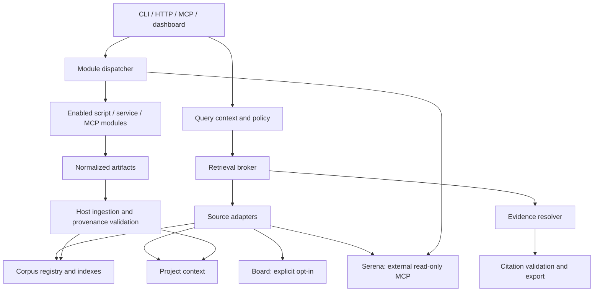

# Knowledge Engine roadmap V2: implementation design

Status: **proposed**, reviewed against PR #34 head
`7e65049d554da4563daec9e5307eb512acf1b8a7` on 2026-10-30.
V2 identifies this planning revision, not a package downgrade from 3.0.0.
Nothing in this document adds runtime functionality by itself.

Read [ROADMAP.md](ROADMAP.md) for sequencing and issue links,
[ARCHITECTURE.md](ARCHITECTURE.md) for current behavior, and
[CONTRIBUTING.md](../CONTRIBUTING.md) for compatibility and contribution rules.

## Review conclusions and boundaries

The modernization provides a sound base: versioned migrations, typed settings,
an official MCP server, a corpus registry, optional embeddings, and separate
project-context, board and tool-host substrates. Extend those boundaries rather
than consolidate all knowledge into one index or create a second tool runner.

| Observed boundary | Consequence | Proposed response |
| --- | --- | --- |
| Corpus kinds describe packaging, not research domains | A library/skill filter cannot separate research topics or projects | Orthogonal scope, collection and research-type metadata |
| Search results contain path, snippet and score, without revision identity | A useful hit cannot yet serve as durable evidence | Source revisions and typed locators before citation rendering |
| MCP group loaders enumerate built-in groups | A hosted utility does not automatically become an MCP tool | Versioned module manifest and shared dispatcher |
| FTS walks nested entries; vector resolution chooses longest prefix | Entry attribution and fusion may disagree | Reproduce and resolve [#39](https://github.com/ARC-907/knowledge-engine/issues/39) before broker reuse |
| Browser tests are opt-in and not enabled in CI | Backend green does not establish dashboard behavior | [#40](https://github.com/ARC-907/knowledge-engine/issues/40) |
| README recommends an unpublished release tag | Installation instructions can fail before publication | Use a source checkout until a release exists |

This is a source/design review, not a new full security audit or execution of the
historical 1177-test suite. Reported historical results must retain that context.

Initial delivery excludes an automatic plugin marketplace, arbitrary Python
plugin imports, multi-tenant authentication, a replacement for Serena's language
servers, and mandatory external providers. Existing utilities are integration
targets; their code, licenses and interfaces must be inventoried before promising
that they can be used unchanged.

## Proposed component and data flow

The broker owns normalization, budgets and routing; adapters own source-specific
search/open behavior. Stores retain originals and existing migration ownership.
The module manager owns executable capabilities; the corpus registry owns
indexable content. A corpus entry of kind tool is documentation/data and never
implicitly grants execution permission.

## Organization contract

| Dimension | Meaning | Rule |
| --- | --- | --- |
| Workspace | Explicit configured knowledge boundary | Stable opaque ID; display name may change |
| Project | Optional narrower context | Project ID, never a directory basename as identity |
| Source | System owning the record | Namespaced source ID; independent adapter/store |
| Collection | Curated domain or research grouping | Stable ID; many-to-many membership |
| Research type | Controlled content classification | reference, paper, article, transcript, code, note, dataset, synthesis, other |
| Tags | Flexible labels | Normalized strings; useful for discovery, never authorization |
| Curation status | Review maturity | unclassified, inbox, reviewed, archived |
| Entry kind | Existing corpus packaging | library, skill, kit, tool remain unchanged |

Collections may contain mixed research types. A code project and a research
collection are distinct dimensions. Generated syntheses preserve links to their
inputs and never inherit the status of primary evidence automatically.
Unknown research types fail validation; uncertain legacy records use other.
Do not infer reviewed status or collection membership from model output.

Legacy corpus content remains in its existing corpus boundary with unclassified
metadata until explicitly assigned. It is not copied into every project.
A default collection is an organizational convenience, not a shared permission.
An explicit project query excludes workspace-wide content unless requested.

Logical taxonomy does not create access control. Existing local-trust APIs remain
local-trust. If deployed behind authentication, a trusted boundary constructs the
principal and allowed scopes; callers cannot grant themselves scope via JSON.
Where physical separation is required, retain separate configured stores and
enforce that boundary in every adapter and evidence-open operation.

### Query and adapter contracts

The contract names below are implemented in this branch as versioned Pydantic
models in `knowledge_engine.knowledge.contracts` (schema version 1, JSON Schema
pinned in `engine/tests/snapshots/knowledge_contracts.json`), with the error
codes in `knowledge_engine.knowledge.errors` and the protocol in
`knowledge_engine.knowledge.adapter`. The broker itself (P2) is not.

- QueryContext: schema_version, workspace_id, optional project_id,
  selected source_ids/collection_ids/research_types/tags, include_workspace,
  mode, limit, timeout_ms, byte_budget, optional trusted principal.
- SourceAdapter: describe_capabilities, health, search(context, query),
  open(context, record_id, revision_id, locator).
- SearchHit: source_id, record_id, revision_id, scope, collection_ids,
  research_type, title, locator, excerpt, provenance_id, ranking metadata.
- SearchEnvelope: hits, effective_scope, source_status, partial, warnings,
  next_cursor when supported, contract_version.
- OpenResult: identity, exact revision, content/media type, locator,
  verification status, digest, provenance and source availability.

Missing context follows the documented legacy corpus default only on the old
surface. New broker calls require an explicit workspace. Unknown IDs are
validation errors, not empty/global queries. Empty explicit selections mean no
sources; omitted selections use the named configured profile. Tags are ANDed;
multiple values within source/collection/type lists are ORed. Dimensions are
ANDed. Record those semantics in schema examples and parity tests.

Sequence for each broker search:

1. Validate schema and scope; resolve allowed configured sources.
2. Take a consistent metadata/policy snapshot for the request.
3. Pass scope and filters to each adapter before candidate ranking and limit.
4. Enforce per-source deadline, candidate and byte caps.
5. Normalize hits; retain native rank/score provenance. Never compare raw BM25
   values directly with cosine scores across stores.
6. Recheck visibility, deduplicate by source-owned record/revision identity and
   fuse ranks deterministically; use a stable identity as tie breaker.
7. Apply the final limit and return effective scope plus source diagnostics.

Initially use bounded per-source candidates and RRF; document that bounded
fusion approximates a full-corpus ranking. Deduplication merges repeated hits of
one record, not unrelated records that happen to have identical text.
For multi-collection records, merge membership metadata rather than duplicate
the hit. Resolve nested entry ownership in #39 independently of collections.

An unavailable optional source produces partial=true and a typed source status.
If every selected source fails, return an unavailable error, not a successful
empty list. No matches is a successful empty list with healthy source statuses.
A requested vector mode without a configured index is an explicit error; never
silently label FTS as vector. Scope validation errors fail the whole request.
Cursor state, where added, binds query/filter hash and index generation.

Preserve legacy search names, parameters, result arrays and score meanings.
Introduce a separately versioned broker surface first; do not silently repurpose
the existing search tool into a global cross-store search. Add HTTP/CLI/MCP
bindings around one broker service and freeze schemas before dashboard work.

## Source identity, evidence and citations

### Proposed records

| Record | Required identity and metadata |
| --- | --- |
| SourceRecord | source_id + stable record_id; scope; canonical URI or relative logical path; bibliographic fields; rights/retention metadata |
| Revision | revision_id; record_id; SHA-256 of retained bytes; media type; observed_at; upstream version/date if known |
| EvidenceSpan | revision_id; typed locator; exact excerpt digest; extraction method/version |
| Derivation | parent revision IDs; module ID/version; parameters digest; output revision IDs; run ID |
| Citation | schema_version; stable evidence identity; locator; export metadata; verification state |

A content hash identifies bytes, not ownership: two records can share bytes while
retaining distinct source identities. Reindexing never changes record/revision
identity. Path changes update aliases; source edits create a new revision.
Do not use database row IDs or regenerated chunk ordinals as citation identities.

Locators are a tagged union: text uses heading plus exact byte/span convention;
PDF uses page and optional bounding box when extraction supports it; transcript
uses start/end milliseconds and speaker when known; code uses repository ID,
commit, relative path, qualified symbol and range. Specify offset units and range
inclusivity in fixtures before implementation. Dirty code requires a snapshot
digest and must not be represented as a clean commit citation. An extractor that
cannot recover page/time position returns unsupported, not invented locators.

### Ingestion and resolution sequence

1. Module fetch/extract returns an artifact descriptor, source metadata and
   declared derivation inputs; host validates size, media type and scope.
2. Preserve allowed original bytes or a digest plus external locator if retention
   is prohibited; record why bytes are unavailable.
3. Create/reuse a source record using source-specific identity rules. Same
   idempotency key and inputs must not create duplicate revisions.
4. Compute digest and commit immutable revision/provenance metadata atomically
   within the owning store. Separate stores use an idempotent outbox/checkpoint
   rather than pretending to share one cross-database transaction.
5. Extract text/segments into derived records and persist typed locators.
6. Build disposable FTS/vector indexes referencing those revisions. Mark an index
   generation ready only after reconciliation; preserve the prior ready generation
   if extraction/indexing fails.
7. On open or citation export, recheck scope, load the exact revision, verify
   digest/span and report availability. Never follow a stale reference silently
   to the latest revision.

Verification states: verified (matching retained revision/span), stale (upstream
changed but cited revision known), unavailable (bytes no longer accessible),
ambiguous (identity/locator has multiple matches), unsupported (no usable locator).
These states describe evidence resolution, not the truth of a generated claim.

First export formats: deterministic Markdown inline references/reference list
and CSL-JSON. Missing author/date remain explicitly absent; escape titles and URLs;
deduplicate references by evidence identity. Bibliography formatting uses recorded
metadata. Additional styles/BibTeX follow only after fixtures establish correct
escaping and metadata mapping.

Citation production accepts a claim-to-evidence map. For generated answers,
validate that cited evidence resolves and supports the quoted passage; flag
claims without adequate evidence. Automated semantic checks are advisory, not
proof of entailment. Keep original quotations separate from model paraphrases.
A transcript of a video and an article discussing it are separate sources linked
by provenance, not interchangeable citations.

Retention policy is operator-configured. Deletion can remove retained bytes and
derived indexes while leaving a minimal tombstone when policy permits.
Citation resolution then returns unavailable. Privacy/rights deletion takes
precedence over perfect reproducibility; do not promise indefinite retention.

## Modular utility contract

Use the existing tool host as an execution substrate and MCP toolkit as a
registration substrate. Add one shared module catalog/dispatcher rather than
separate HTTP, CLI and MCP implementations.

### Manifest and lifecycle

A proposed manifest version 1 contains:

| Field | Validation |
| --- | --- |
| module_id, version, manifest_version | Stable namespaced ID, semantic module version, supported integer schema version |
| engine_compatibility | Explicit supported engine/contract range |
| license, description | Public module metadata and attribution |
| transport | script, service or external MCP; configuration is operator-approved |
| tools | Stable public name, description, input/output JSON Schemas, effect classification |
| capabilities | Declared read/write/network/process needs; host policy is authoritative |
| configuration | Named settings and secret references, never embedded values |
| limits | Deadline, concurrency, input/output bytes, artifact bytes |
| health | Optional bounded probe, separate from discovery |

Validate the manifest as data before any imports/process/network calls.
Install, configure, enable, discover and invoke are distinct operations.
No auto-installation on query, no execution from a watched corpus folder.
Public MCP names derive deterministically from module ID + tool ID and must
satisfy SDK/client constraints; reject collisions and reserve built-in names.
Freeze advertised schemas for a session; initial delivery requires restart after
catalog changes. Hot reload and change notifications are later work.

Lifecycle: registered -> disabled -> starting -> ready, with degraded/failed
states and stopped on shutdown. Persist intent/configuration separately from
observed health. Enablement checks compatibility, configuration and host grants.
A module failure removes only that module's availability; core search still starts.
Disable rejects new work, drains/cancels active calls within a deadline, then
closes clients and child processes. Do not kill external services the host does
not own.

### Invocation sequence

1. Resolve enabled module and namespaced tool; capture catalog version/run ID.
2. Validate input schema and scope; intersect requested capabilities with host
   policy. Read-only is enforced through allowed operations, not a descriptive flag.
3. Apply concurrency limit, deadline and output/artifact budget.
4. Invoke through the existing script/service substrate or an MCP client adapter.
   Script calls use argv without a shell; service/MCP destinations come from
   approved configuration, never arbitrary caller-supplied endpoints.
5. Validate output schema; normalize artifacts and typed errors.
6. Optionally submit artifacts to host ingestion with explicit destination scope.
7. Record sanitized outcome, elapsed time, module version, provenance IDs and
   policy decision. Do not log credentials or full research content by default.

Errors distinguish invalid_input, denied, unavailable, incompatible,
timeout, cancelled, output_invalid and internal_error. MCP translates failures
to tool error results consistently. Only declared idempotent operations can retry
automatically, with bounded attempts. Transcription/download calls may be long
running: return a scoped job ID, support status/cancel and expiry, and never hold
one MCP request open indefinitely. Cancellation must reach owned subprocesses.

A local process is not sandboxed merely because it is a module. Document the
deployment trust boundary and support an external isolation provider when needed.
In-process plugin entry points and arbitrary imported Python code are deferred.

### Reference integrations

- Media/news utility: fetch approved public inputs, return canonical source URLs,
  published/retrieved timestamps, rights metadata and content artifacts.
- Transcription utility: accept an approved artifact ID, return language,
  timestamped segments, engine/model version and parent artifact provenance.
- Both have synthetic offline fixtures; live-provider checks are opt-in.
- Registering either should require a module package/manifest and operator config,
  with zero edits to the central MCP group loader.

Inventory the actual existing programs first: CLI/API, license, runtime versions,
credentials, file formats, deployment needs and operational limits. Wrap them;
do not copy business logic into the engine. Missing source code is an explicit
implementation dependency, not permission to invent its interface.

## Serena integration

Assumption: Serena means [oraios/serena](https://github.com/oraios/serena).
Upstream README inspected 2026-10-30 documents external MCP launch/HTTP,
symbol navigation and references, editing/shell operations, and a REPL interface.
These are upstream observations, not a tested compatibility claim.

Use an optional external MCP adapter with an operator-installed, pinned Serena
version. Keep language-server lifecycle and semantic caches owned by Serena.
Knowledge Engine owns scope, normalized hits, module policy and citations.
Do not import Serena implementation into the core.

Start with symbol lookup, file outline and reference lookup. At implementation
time, negotiate protocol and inspect tool schemas on the pinned version. Expose
only explicitly mapped read operations. Do not forward generic shell, edit or
REPL execution tools to implement a read-only facade. If the selected release
offers no sufficiently constrained read interface, mark the adapter incompatible
until a safe supported mapping exists.

Project routing uses configured project IDs, repository identity and allowed
roots, never the current working directory alone. Prefer one MCP session/process
per project. Where activation is mutable in a shared session, hold one lock across
activation plus the complete call. Concurrent project calls and reconnects must
not cross-contaminate context. Validate the returned file belongs to the requested
project and bind evidence to the observed revision; mark races stale and retry
only within the request budget.

Missing language servers, unsupported languages, upstream schema drift, unavailable
Serena and project mismatch return typed diagnostics. None blocks corpus search.
Memory import is explicit and source-labelled; Serena memories do not become
reviewed research automatically. Defer code edits/refactors to a separately
designed write capability with its own authorization and recovery contract.

Before release, record Serena version/commit, protocol, exact tool mapping,
language backend/runtime and tested languages. Supply a Python fixture first;
add languages only with evidence. The upstream README currently identifies
SolidLSP as MIT and the Serena application as GPL-3.0-or-later. Review the pinned
licenses before any bundling or redistribution; an external adapter does not
justify relabelling upstream code as MIT.

## Migration, rollout and rollback

Steps 1–4 for the scoped-knowledge metadata are implemented in this branch by
`knowledge-engine knowledge migrate --dry-run|--apply` (module
`knowledge_engine.knowledge.backfill`; operator guide in
[SCOPED-KNOWLEDGE.md](../01-user-docs/SCOPED-KNOWLEDGE.md)).

1. Capture schema/index generations and a backup of authoritative stores.
2. Run a read-only dry-run reporting record counts, scope assignments, duplicate
   identity risks, unknown metadata and required disk space.
3. Add versioned metadata/revision tables through the existing owning-store
   migration runner; avoid a new migration framework.
4. Backfill in resumable batches, preserving old IDs and source ownership.
   Persist checkpoints; rerunning must not duplicate records.
5. Build new disposable indexes beside the old generation and reconcile counts,
   scope partitions, references and representative queries.
6. Enable new broker/module surfaces explicitly for a small fixture corpus.
   Keep legacy routes and native stores usable.
7. Promote only after acceptance gates and migration evidence pass.

Rollback disables new surfaces and restores compatible old indexes/configuration.
Do not run an old binary against a newer incompatible schema; restore the tested
backup if necessary. Document backup age and any accepted loss of post-backup
writes. Never delete the old authoritative copy solely because indexing finished.

## Verification and completion gates

| Gate | Required witness |
| --- | --- |
| Organization | Identical titles/symbols across two projects, multi-collection record, unknown scope rejected, zero out-of-scope hits |
| Retrieval | Filters before limit, deterministic fusion, nested-entry regression, all-source failure distinguished from no matches |
| Evidence | Citation resolves after reindex; edited/deleted originals yield explicit state; no generated metadata |
| Modules | Two utilities work through one dispatcher; invalid schemas/collisions denied; timeout/cancel cleans up |
| Serena | Two-project concurrency/restart checks; read-only allowlist; absent/incompatible upstream keeps core working |
| Interfaces | HTTP/CLI/MCP parity and versioned snapshots; dashboard filter and citation navigation browser smoke |
| Migration | Legacy fixture -> additive upgrade -> restart -> idempotent rerun; count/digest reconciliation; documented restore |
| Public release | Clean wheel install with no checkout-only assets; portable examples, dependency/license review, release checklist |

Use deterministic fake providers and synthetic projects in required CI.
Live Serena/provider integrations are separately version-pinned opt-in checks.
Required PR validation follows CONTRIBUTING: lint, type check, affected tests,
schema/OpenAPI/MCP snapshots, docs paths and build smoke where packaging changes.
Each implementation PR supplies its own exact command/results; a roadmap checkbox
is not test evidence.

Before changing the vector backend, baseline representative corpus sizes
(1k/10k/100k records where feasible), p50/p95 search latency, index build time,
peak memory and retrieval quality using a frozen query set. Record hardware only
in neutral benchmark methodology, never as required operator configuration.
Choose explicit acceptance budgets before comparing candidates; do not claim
an ANN backend is necessary without measured constraints.

## Decisions to close during the contract PR

Implemented in this branch: default legacy/workspace inclusion and filter
semantics (ADR 0006), record/revision identity and locator units (ADR 0007),
retention/tombstones (ADR 0008), module catalog persistence/restart (ADR 0009)
and the deferral of the exact Serena mapping (ADR 0010); nested entry
ownership is [ADR 0005](adr/0005-nested-entry-ownership.md) from the R0 slice. See [adr/](adr/README.md).

Record these as proposed ADRs before implementation depends on them: nested
entry ownership versus membership; default legacy/workspace inclusion; canonical
record/revision identity and locator units; retention/tombstone policy; module
catalog persistence and restart behavior; exact Serena compatibility mapping.
Maintainers review the concrete schemas and fixtures in that PR. Proposed design
does not override accepted ADRs or silently authorize breaking public changes.
